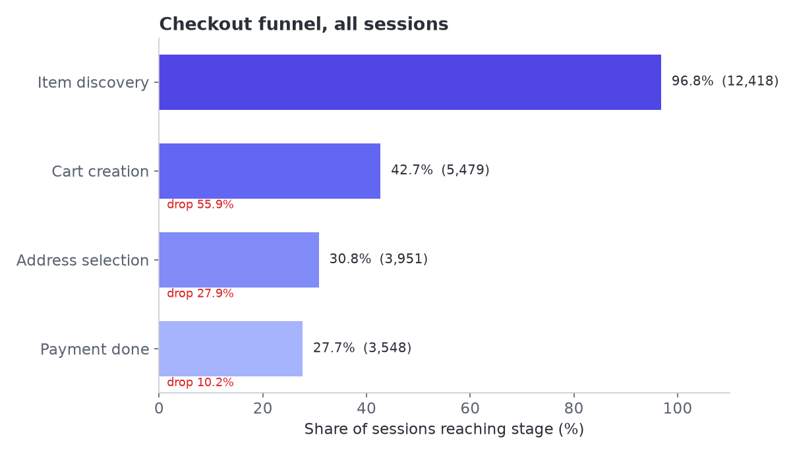
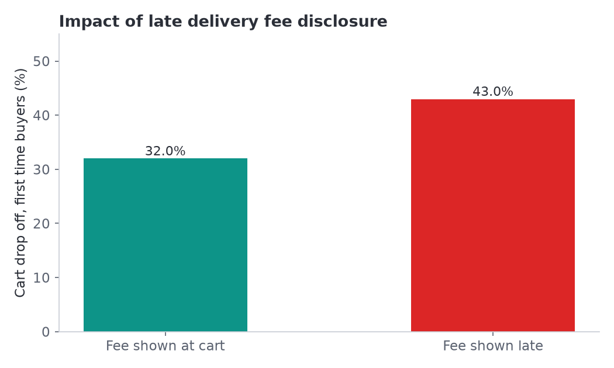
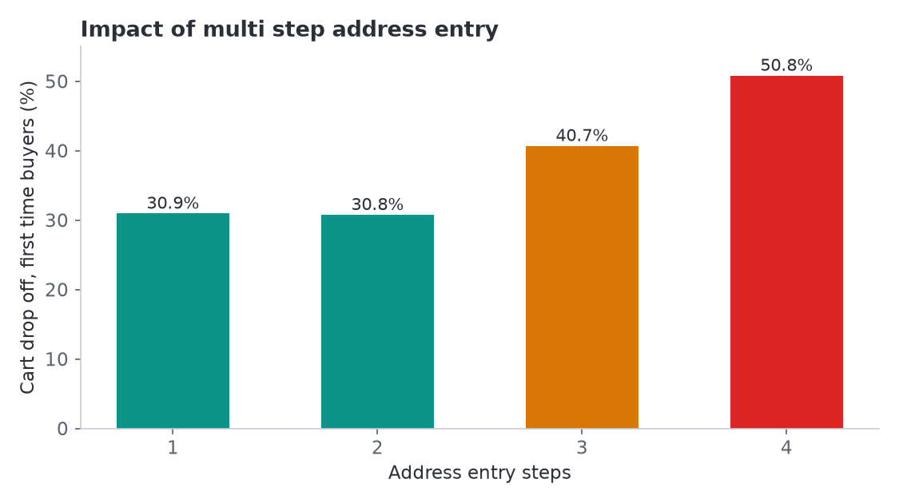
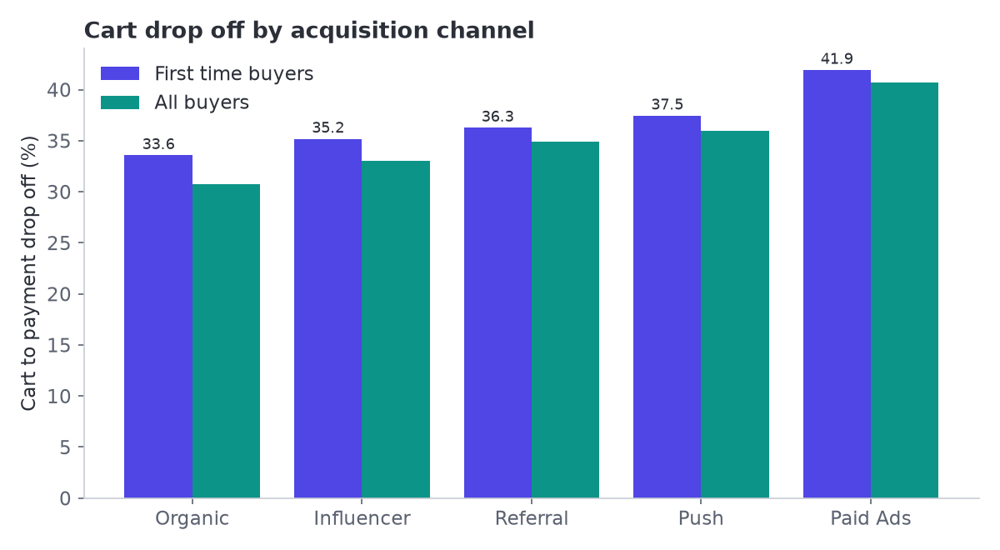
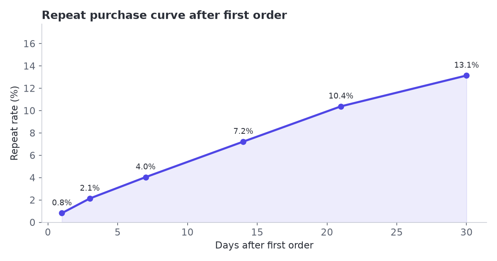
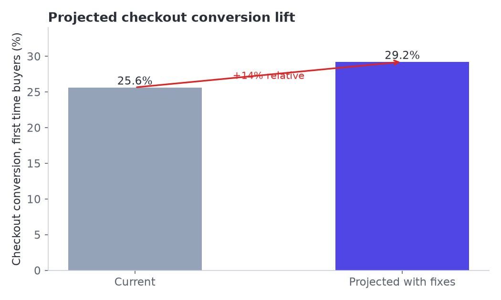

# Quick-Commerce Checkout Funnel and Retention Study

A product analytics case study on where users drop out of a quick-commerce checkout, why they drop out, and what to build to fix it.

This repo contains a full simulation of 12,000+ user sessions, the SQL and Python used to analyse them, the charts that come out of that analysis, and the product artefacts that follow from the findings (a PRD, checkout wireframes, a Mixpanel tracking plan and an A/B test plan).

Everything here runs end to end from a clean checkout of the repo. No external data is needed.

---

## The problem in one line

Roughly 38% of first time buyers who add an item to cart never reach a successful payment, and the two biggest reasons are late delivery fee disclosure and multi step address entry.

## Headline results

| Metric | Value |
| --- | --- |
| Sessions analysed | 12,824 |
| Events analysed | 59,982 |
| Unique users | 11,700 |
| Orders | 3,548 |
| Overall checkout conversion | 27.7% |
| First time buyer conversion | 25.8% |
| Repeat buyer conversion | 47.2% |
| Cart to payment drop, first time buyers | 37.2% |
| Cart to payment drop, repeat buyers | 21.0% |
| Cart to payment drop when fee shown late | 43.5% |
| Cart to payment drop when fee shown at cart | 32.2% |
| Cart to payment drop at 4 address steps | 50.8% |
| Average order value | Rs 358 |
| 30 day repeat rate | 13.2% |

## The funnel

| Stage | Sessions | Share of top | Step drop |
| --- | --- | --- | --- |
| Item discovery | 12,418 | 96.8% | 3.2% |
| Cart creation | 5,479 | 42.7% | 55.9% |
| Address selection | 3,951 | 30.8% | 27.9% |
| Payment done | 3,548 | 27.7% | 10.2% |



The single biggest leak is between discovery and cart creation. The most expensive leak in rupee terms is between cart and payment, because that user has already shown buying intent.

## What drives the cart drop

Two factors explain most of the gap between first time and repeat buyers.

**Late delivery fee disclosure.** When the delivery fee is revealed only at the payment step, the cart drop for first time buyers is 43.5%. When it is shown at the cart, the drop is 32.2%. That is an 11 point swing from one line of copy placement.



**Multi step address entry.** Address entry with one or two steps holds around 77% of cart users. At three steps it falls to 66.9%, and at four steps it falls to 54.5%. Every extra step costs conversion.



## Channel view

| Channel | Sessions | Cart rate | Conversion | First time cart drop | 30 day repeat |
| --- | --- | --- | --- | --- | --- |
| Organic | 3,310 | 48.3% | 33.5% | 33.6% | 19.2% |
| Referral | 1,638 | 44.4% | 28.9% | 36.3% | 11.4% |
| Push | 2,599 | 42.4% | 27.1% | 37.5% | 11.9% |
| Influencer | 1,478 | 39.4% | 26.4% | 35.2% | 11.0% |
| Paid Ads | 3,799 | 38.7% | 23.0% | 41.9% | 9.2% |



Paid Ads brings in the most sessions and converts the worst. Organic brings in fewer sessions and converts the best, and also retains best. This is a classic intent quality gap, and it means checkout friction hurts paid traffic the most because those users have the least patience.

## Retention



30 day repeat sits at 13.2% overall. It ranges from 19.2% for Organic to 9.2% for Paid Ads. Users whose first order involved a late fee reveal or four address steps repeat less, which links checkout friction directly to lifetime value, not just to the first order.

## What we recommend building

1. Show the delivery fee on the cart screen, before address entry, so there is no surprise at payment.
2. Collapse address entry to a single screen with saved addresses and pin code auto fill.
3. Add a one tap UPI retry on payment failure instead of sending the user back to the cart.
4. Route paid traffic to the streamlined checkout first, since it has the most to gain.

The A/B test plan projects a 14% relative lift in checkout conversion and a 9% relative lift in 30 day repeat.



## Repo layout

```
.
├── README.md
├── requirements.txt
├── data/
│   ├── users.csv
│   ├── sessions.csv
│   ├── events.csv
│   └── orders.csv
├── sql/
│   ├── 01_schema.sql
│   ├── 02_funnel.sql
│   ├── 03_segments.sql
│   └── 04_cohort_retention.sql
├── python/
│   ├── gen_data.py
│   ├── load_db.py
│   ├── analyze.py
│   ├── charts.py
│   └── run_all.py
├── docs/
│   ├── PRD.md
│   ├── ab_test_plan.md
│   ├── tracking_plan.md
│   ├── methodology.md
│   ├── insights.md
│   └── wireframes.html
└── outputs/
    ├── charts/
    └── *.csv
```

## How to run

```bash
pip install -r requirements.txt
python python/run_all.py
```

`run_all.py` regenerates the data, loads it into a local SQLite database, runs the analysis, builds the charts, and prints a KPI summary. The SQL in `sql/` is plain SQLite compatible SQL and can be run against any warehouse that supports window functions.

To run a single step:

```bash
python python/gen_data.py
python python/analyze.py
python python/charts.py
python python/load_db.py
```

## Data model

Four tables. `users` holds one row per user with acquisition channel, device and city tier. `sessions` holds one row per shopping session with the funnel flags and checkout attributes. `events` holds the raw event stream in long form. `orders` holds one row per completed order.

The funnel is defined by four flags on `sessions`: `reached_view`, `reached_cart`, `reached_addr`, `reached_pay`.

## Notes on the data

The data is simulated, not real user data. It is generated with a fixed seed so results are reproducible. The generation logic encodes the hypotheses being tested (late fee disclosure and multi step address entry both hurt conversion) so that the analysis pipeline can be demonstrated end to end. Treat the numbers as a worked example of the method, not as a claim about any real company. See `docs/methodology.md` for the full breakdown.

## Product documents

- [PRD](docs/PRD.md) for the streamlined checkout.
- [A/B test plan](docs/ab_test_plan.md) for the measurement design.
- [Tracking plan](docs/tracking_plan.md) for the Mixpanel event spec.
- [Methodology](docs/methodology.md) for how the data and metrics are built.
- [Insights](docs/insights.md) for the written readout.
- [Wireframes](docs/wireframes.html) for the checkout mockups.
